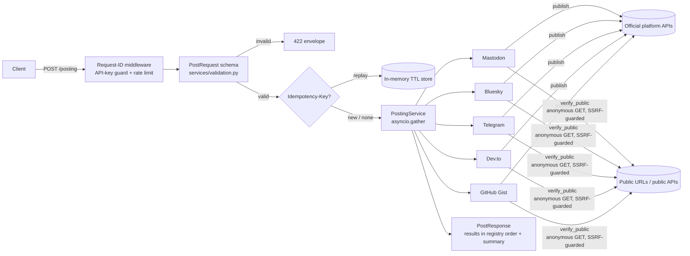

# Automated Multi-Platform Posting API

A FastAPI service that takes **one short message containing exactly one CTA link** and publishes it to several
third-party platforms through their **official APIs**: Mastodon, Bluesky, Telegram, Dev.to, and GitHub Gist,
plus optional WordPress, LinkedIn, and Discord adapters. Each platform is reported independently, and one
failing platform never blocks the others. Every successful post is then checked **anonymously** to confirm
it is publicly reachable.

```
POST /posting   {"message": "Check out our latest business platform and grow your online visibility. https://example.com"}
```

- Python 3.11+, FastAPI, Pydantic v2, pydantic-settings, async HTTPX, pytest + respx, ruff
- Run: `uvicorn app.main:app --host 0.0.0.0 --port 4000`. Swagger UI: <http://localhost:4000/docs>

---

## Contents

1. [Architecture](#architecture)
2. [Platforms: what was chosen and why](#platforms-what-was-chosen-and-why)
3. [Credential setup per platform](#credential-setup-per-platform)
4. [Setup and run](#setup-and-run)
5. [API reference](#api-reference)
6. [Design decisions](#design-decisions)
7. [Retry and idempotency policy](#retry-and-idempotency-policy)
8. [Security](#security)
9. [Testing](#testing)
10. [Docker](#docker)
11. [How to add a platform](#how-to-add-a-platform)
12. [Limitations](#limitations)
13. [Verification status: live vs mocked](#verification-status-live-vs-mocked)

---

## Architecture



Each platform runs in its own task: **publish, then timestamp, then verify**. Platform A's verification overlaps with
platform B's publishing. Each task is wrapped in `asyncio.wait_for(PLATFORM_TIMEOUT_SECONDS)` and catches every
exception, so a crash or hang in one adapter becomes a single failed result.

```
app/
├── main.py                  # app factory, lifespan (shared httpx.AsyncClient), handlers, middleware, routes
├── schemas.py               # PostRequest, PlatformResult, PostResponse, error models
├── config.py                # Settings (pydantic-settings, SecretStr for all credentials)
├── core/
│   ├── errors.py            # ErrorCode + PlatformError(code, message, retryable, outcome_unknown, ...)
│   ├── logging.py           # JSON logs, request-id contextvar, secret redaction
│   └── timeutil.py          # now(tz) -> (date, time)
├── services/
│   ├── validation.py        # message + CTA link rules (pure, no network)
│   ├── posting_service.py   # orchestration, isolation, timeouts, verification
│   ├── public_check.py      # anonymous GET with host allow-list and manual, re-checked redirects
│   ├── idempotency.py       # opt-in Idempotency-Key store (TTL, bounded, concurrency-safe)
│   └── rate_limit.py        # per-IP sliding window
└── platforms/
    ├── __init__.py          # PLATFORM_REGISTRY + get_enabled_platforms()
    ├── base.py              # BasePlatform, PostOutcome, shared retry + HTTP error mapping
    ├── mastodon.py  bluesky.py  telegram.py  devto.py  github_gist.py
    └── wordpress.py linkedin.py discord.py          # optional, disabled by default
```

---

## Platforms: what was chosen and why

The selection criteria were: a **free official API** that a new developer account can use **today**, posts that are
**publicly viewable without login** (so `public_access` can actually be verified), and simple auth (a token or app
password, with no app review).

| Platform | Status | Why |
|---|---|---|
| **Mastodon** | Core | Free, open REST API, token in 1 minute, public statuses, supports `Idempotency-Key` |
| **Bluesky** | Core | Free AT Protocol API with app passwords; public AppView API allows real verification |
| **Telegram** | Core | Free Bot API; public channels have an anonymous web preview (`t.me/s/<channel>`) |
| **Dev.to** | Core | Free Forem API key; articles are public pages |
| **GitHub Gist** | Core | Free, stable REST API; public gists are anonymous pages |
| WordPress | Optional | Works with any self-hosted/public HTTPS site via Application Passwords; needs a public site |
| LinkedIn | Optional | Posts API needs an approved app product and a 60-day token; **login wall**, so it cannot be verified anonymously |
| Discord | Optional | Webhooks are trivial, but messages need a login to view, so they cannot be verified anonymously |
| **X / Twitter** | Rejected | Write access is pay-per-use / paid tier; not reasonable for this assignment |
| **Medium** | Rejected | The publishing API is deprecated and no longer issues new integration tokens |
| **Facebook / Instagram** | Rejected | Require Meta app review, business accounts and page permissions |
| **Reddit** | Rejected | API terms and anti-spam rules make automated promotional posting inappropriate |

> **API docs.** The current official docs for each platform were checked on 2026-11-19. The full table, with doc
> URLs, auth, request fields, response field used for `posted_url`, and rate limits, is in
> [`docs/api_research.md`](docs/api_research.md). Where the docs differed from the original brief, the code follows the docs:
> 1. **Dev.to `tags`** is a comma-separated *string* in the Forem v1 schema, not an array.
> 2. **GitHub** returns *both* primary and secondary rate limits as 403 **or** 429. A 403 with `x-ratelimit-remaining: 0`
>    or a `retry-after` header is mapped to `RATE_LIMITED`, not `AUTH_FAILED`.
> 3. **Bluesky** enforces `maxLength: 3000` UTF-8 bytes in addition to 300 graphemes.
> 4. **Mastodon** `verify_credentials` needs the `profile` (or `read:accounts`) scope, so the token needs `write:statuses` + `profile`.
> 5. **LinkedIn** `LINKEDIN_VERSION` defaults to `202611`, the latest listed version. The old `202510` default falls outside the listed active versions.
> 6. Telegram reports flood control in the JSON body (`parameters.retry_after`), which is read for `RATE_LIMITED`.

---

## Credential setup per platform

Use **dedicated test accounts**. Put the values in `.env`, which is git-ignored; never commit them.

### Mastodon
1. Create a test account on an instance (e.g. <https://mastodon.social>).
2. Go to **Preferences → Development → New application** (`<instance>/settings/applications`).
3. Grant the scopes `write:statuses` (to post) and `profile` (read-only, used by `scripts/check_credentials.py` via
   `verify_credentials`). Save, then copy **Your access token**.
4. Set `MASTODON_BASE_URL=https://<instance>` and `MASTODON_ACCESS_TOKEN=...`.

### Bluesky
1. Create a test account at <https://bsky.app>.
2. Go to **Settings → Privacy and security → App passwords → Add App Password** (do *not* use your main password).
3. Set `BLUESKY_HANDLE=yourname.bsky.social` and `BLUESKY_APP_PASSWORD=<your-app-password>`.

### Telegram
1. Talk to [@BotFather](https://t.me/BotFather), send `/newbot`, and copy the token.
2. Create a **public** channel with a username (e.g. `@my_test_channel`).
3. Channel → Administrators → add your bot with **Post messages** permission.
4. Set `TELEGRAM_BOT_TOKEN=...` and `TELEGRAM_CHANNEL_USERNAME=my_test_channel`.

### Dev.to
1. Create a test account at <https://dev.to>.
2. Go to **Settings → Extensions → DEV Community API Keys → Generate API Key** (<https://dev.to/settings/extensions>).
3. Set `DEVTO_API_KEY=...` and optionally `DEVTO_TAGS=automation,api,python` (max 4).
   *New Dev.to accounts may be rate-limited on article creation for the first days.*

### GitHub Gist
1. Go to <https://github.com/settings/tokens> → **Generate new token (classic)** → only the **`gist`** scope.
   (A fine-grained token with account permission **Gists: read & write** also works.)
2. Set `GITHUB_TOKEN=...`.

### Optional adapters
| Platform | Env | Where |
|---|---|---|
| WordPress | `WP_SITE_URL`, `WP_USERNAME`, `WP_APP_PASSWORD` | wp-admin → Users → Profile → **Application Passwords** (HTTPS site required) |
| LinkedIn | `LINKEDIN_ACCESS_TOKEN`, `LINKEDIN_AUTHOR_URN`, `LINKEDIN_VERSION` | <https://www.linkedin.com/developers/apps> → product **Share on LinkedIn** → OAuth token with `w_member_social` |
| Discord | `DISCORD_WEBHOOK_URL`, `DISCORD_GUILD_ID` | Server Settings → Integrations → Webhooks; enable Developer Mode to copy the server ID |

Then enable them, e.g. `ENABLED_PLATFORMS=mastodon,bluesky,telegram,devto,gist,wordpress`.

---

## Setup and run

```bash
# 1. virtualenv
python -m venv .venv
source .venv/bin/activate            # Windows PowerShell: .venv\Scripts\Activate.ps1

# 2. install (runtime + test tooling)
pip install -r requirements-dev.txt  # or: pip install -r requirements.txt  (runtime only)

# 3. configure
cp .env.example .env                 # Windows: copy .env.example .env
#    edit .env and fill in the credentials (see above)

# 4. run
uvicorn app.main:app --host 0.0.0.0 --port 4000
```

- Swagger UI: <http://localhost:4000/docs>, ReDoc: <http://localhost:4000/redoc>
- Check configuration before posting: `curl -s http://localhost:4000/platforms`
- Develop without posting anything: set `DRY_RUN=true`.

### curl samples

```bash
# success (all configured platforms)
curl -s -X POST http://localhost:4000/posting -H "Content-Type: application/json" \
  -d '{"message": "Check out our latest business platform and grow your online visibility. https://example.com"}'

# partial failure: set DEVTO_API_KEY=wrong in .env, restart, send the same request.
# HTTP 200, success=true, summary.failed=1, Dev.to -> "AUTH_FAILED: ..."

# 422: two links
curl -s -X POST http://localhost:4000/posting -H "Content-Type: application/json" \
  -d '{"message": "See https://example.com and https://example.org"}'
```

More examples are in [`docs/sample_requests.md`](docs/sample_requests.md) and [`docs/sample_responses.md`](docs/sample_responses.md).

---

## API reference

### `POST /posting`

**Request body:** exactly one field. Any other field is rejected with `unknown_field`, so the client cannot choose platforms.

```json
{ "message": "Check out our latest business platform and grow your online visibility. https://example.com" }
```

Optional headers: `Idempotency-Key` (see below), `X-Request-ID` (echoed back), `X-API-Key` (only if `API_KEY` is set).

#### Validation rules (applied in this order)

| # | Rule | Code |
|---|---|---|
| 1 | Must be a string; trimmed **first**; empty after trimming is rejected | `invalid_type`, `empty` |
| 2 | ≤ 200 characters after trimming (Unicode code points, Python `len`); the error includes the actual length | `too_long` |
| 3 | Any non-http(s) `scheme://` token, or `javascript:` / `data:` / `mailto:` / `file:` | `invalid_url` ("Only http and https links are allowed") |
| 3 | `www.` without a scheme | `invalid_url` ("Include http:// or https://") |
| 4 | Trailing `.,;:!?'"` and *unbalanced* `)`/`]`/`}` are stripped from the link (balanced parentheses such as `wiki/Python_(language)` are kept). The message text itself is posted unchanged. | – |
| 5 | Exactly one link (the same link twice counts as two) | `no_link`, `multiple_links` |
| 6 | Strict URL check (`urllib.parse` + Pydantic `AnyHttpUrl`): http/https; a real domain (valid labels, alphabetic TLD ≥ 2) or a **public** IP; no `user:pass@`; no whitespace or control characters; not `localhost`, `*.local`, `*.internal`, or loopback/private/link-local/reserved IPs | `invalid_url` |

The CTA link is **never fetched**.

All input errors return **HTTP 422** with the same envelope, including malformed JSON (`invalid_json`), missing
field (`missing`), and extra fields (`unknown_field`):

```json
{ "success": false, "error": "Validation failed",
  "details": [ { "field": "message", "code": "too_long", "message": "Message must not exceed 200 characters (got 231)." } ] }
```

#### Response (HTTP 200 for every valid request, even if all platforms failed)

```json
{
  "success": true,
  "summary": { "total": 5, "succeeded": 4, "failed": 1 },
  "results": [
    { "platform": "Mastodon", "status": "success", "posted_url": "https://mastodon.social/@user/123",
      "public_access": true, "date": "2026-11-18", "time": "10:30:00", "error": null },
    { "platform": "Dev.to", "status": "failed", "posted_url": null, "public_access": false,
      "date": null, "time": null, "error": "AUTH_FAILED: Dev.to rejected the credentials (HTTP 401): unauthorized" }
  ]
}
```

| Field | Meaning |
|---|---|
| `success` | `true` if **at least one** platform succeeded. Use `summary` for exact counts. |
| `summary` | `total`, `succeeded`, `failed`. |
| `results[]` | One per **enabled** platform, always in registry order. Exactly these 7 fields: |
| `platform` | Display name (`Mastodon`, `Bluesky`, `Telegram`, `Dev.to`, `GitHub Gist`, …). |
| `status` | `"success"` or `"failed"`. |
| `posted_url` | URL returned by the platform API. `null` on failure, **never fabricated**. |
| `public_access` | `true` only if an **anonymous** request confirmed the post is publicly visible. **`false` means "not verified"**: the post failed, could not be confirmed yet (propagation), or the platform cannot be checked anonymously (LinkedIn, Discord). |
| `date` / `time` | `YYYY-MM-DD` / `HH:MM:SS` at the moment the platform confirmed publication, in `APP_TIMEZONE` (default UTC). `null` on failure. |
| `error` | `null` on success, otherwise `"<CODE>: <sanitized message>"`. |

**Error codes:** `AUTH_FAILED`, `RATE_LIMITED`, `TIMEOUT`, `NOT_CONFIGURED`, `BAD_REQUEST`, `NOT_FOUND`,
`CONTENT_TOO_LONG`, `UNAVAILABLE`, `NETWORK_ERROR`, `UNKNOWN_OUTCOME`, `INVALID_RESPONSE`, `DRY_RUN`, `INTERNAL_ERROR`.

| Upstream | Code |
|---|---|
| 400, 422, other 4xx | `BAD_REQUEST` (includes the API's message, sanitized) |
| 401, 403 | `AUTH_FAILED` |
| 404 | `NOT_FOUND` |
| 429 (or GitHub 403 with `x-ratelimit-remaining: 0`) | `RATE_LIMITED` (reads `Retry-After` or Telegram's `retry_after`) |
| 5xx | `UNAVAILABLE` for idempotent calls; `UNKNOWN_OUTCOME` for non-idempotent posts |
| connect failure / connect timeout | `NETWORK_ERROR` / `TIMEOUT` |
| read timeout after sending | `UNKNOWN_OUTCOME: request timed out after being sent; the post may exist` |

### `GET /platforms`
Enabled platforms, whether each is configured, and which env vars are missing (names only, **never values**):

```json
{ "dry_run": false, "platforms": [ { "key": "gist", "name": "GitHub Gist", "configured": false,
  "missing_env": ["GITHUB_TOKEN"], "public_verification": true } ] }
```

### `GET /health`
`{"status": "ok"}`

### Other errors
`401 {"success": false, "error": "Unauthorized"}` (only when `API_KEY` is set) ·
`429 {"success": false, "error": "Too many requests"}` + `Retry-After` ·
`500 {"success": false, "error": "Internal server error"}` (never a stack trace).

### Configuration

All settings are environment variables; see [`.env.example`](.env.example) for the full annotated list.

| Variable | Default | |
|---|---|---|
| `ENABLED_PLATFORMS` | `mastodon,bluesky,telegram,devto,gist` | Unknown names fail at startup |
| `DRY_RUN` | `false` | No platform calls; each result is `DRY_RUN: not published` |
| `APP_TIMEZONE` | `UTC` | IANA zone for `date`/`time` |
| `PLATFORM_TIMEOUT_SECONDS` | `30` | Per-platform publish budget |
| `HTTP_CONNECT_TIMEOUT` / `HTTP_READ_TIMEOUT` | `5` / `15` | Shared client timeouts |
| `VERIFY_PUBLIC_ACCESS` | `true` | Disable to skip anonymous checks |
| `RATE_LIMIT_PER_MINUTE` | `20` | Per-IP limit on `/posting` (`0` = off) |
| `API_KEY` | empty | If set, `/posting` requires `X-API-Key` |
| `LOG_LEVEL` | `INFO` | |

---

## Design decisions

- **`success` = at least one platform succeeded.** This matches the assignment's own example. `summary` carries exact counts, so clients needing "all succeeded" check `summary.failed == 0`.
- **HTTP 200 on partial or total platform failure; 422 only for invalid input.** Platform failures are per-item outcomes of a valid request, not request errors.
- **No LLM.** The assignment's mention of "supported LLM platforms" is read as the *target* platforms; nothing in the task requires generating or rewriting text, so no LLM is used.
- **The message is never rewritten.** Adapters only *map* it into required fields (a Dev.to/WordPress title derived from the text, a Gist description, LinkedIn's escaped "little text"). The link is never truncated or altered. If a platform's limit is smaller than the message, that platform fails with `CONTENT_TOO_LONG`.
- **Timestamps** are taken right after the platform confirms the post, in `APP_TIMEZONE` (UTC by default).
- **CTA links to localhost or private IPs are rejected**, and the CTA link is never fetched.
- **Idempotency is opt-in.** Without the header, every call posts (repeat test runs must work). Non-idempotent POSTs are **never retried on ambiguous outcomes**; see below.
- **`public_access` is real.** It is computed by an anonymous request, with per-platform logic where a plain GET would lie (see Security).
- **Platform choice is internal** (`ENABLED_PLATFORMS`), and an enabled-but-unconfigured platform is reported as `NOT_CONFIGURED` without any network call. Disabled platforms are not listed at all.
- **`DRY_RUN` never fakes success.** A dry run reports `failed` / `DRY_RUN: not published`.

---

## Retry and idempotency policy

**Retries** (max 2, exponential backoff with jitter, implemented in `BasePlatform._send`):

| Situation | Non-idempotent POST (Bluesky, Telegram, Dev.to, Gist, …) | Idempotent (Mastodon with `Idempotency-Key`) |
|---|---|---|
| Connect error / connect timeout (request never sent) | retry | retry |
| 429 | retry after `Retry-After` (if ≤ 10s; otherwise fail fast as `RATE_LIMITED`) | same |
| 5xx | **no retry**, `UNKNOWN_OUTCOME` | retry with the **same key** |
| Read timeout / connection dropped after sending | **no retry**, `UNKNOWN_OUTCOME` | retry with the **same key** |
| 4xx | no retry | no retry |

This means a retry can never create a duplicate post. Bluesky's cached session token is refreshed once on
`ExpiredToken`/401 (the record was not created in that case, so a single retry is safe).

**Client idempotency (`Idempotency-Key` header):**
- Same key + same message within 10 minutes: the cached response is returned and nothing is posted (`Idempotent-Replayed: true`).
- Same key + different message: 422 `idempotency_conflict`.
- Concurrent requests with the same key wait for the first one, so the post happens once.
- The Mastodon idempotency key is derived from the client key, so even a replay after a server restart is deduplicated by Mastodon (which keeps keys for 1 hour).
- The store is in-memory, bounded (1000 entries), and per-process. Use Redis when running multiple workers.

---

## Security

- **No secrets in the repo.** All credentials come from env vars and are typed `SecretStr`. `.env` is git-ignored, and `scripts/check_no_secrets.sh` (run in CI) scans committed files for token patterns (Telegram, GitHub, JWT, Discord webhooks, Bluesky app passwords, private keys, filled-in env lines) and prints file and line only, never the match.
- **Redaction.** A log formatter and the error sanitizer strip every configured secret value plus token-shaped strings (`bot<token>` URLs, `Bearer …`, `api-key: …`, GitHub tokens, JWTs, webhook URLs). The `httpx`/`httpcore` loggers are kept at WARNING because they would log the Telegram URL, which contains the token. Error text is built from status codes and sanitized API messages, never from exception strings that could contain URLs.
- **SSRF guard on verification.** Only URLs produced by an adapter are fetched, only over https, and only if the host is on that adapter's allow-list (e.g. `gist.github.com`, `dev.to`, `t.me`, `public.api.bsky.app`, the configured Mastodon host). IP-literal hosts are refused. Redirects are followed **manually** (max 3) and every hop is re-checked. The verification client sends no credentials and stores no cookies.
- **Platform-aware verification.** Bluesky checks `public.api.bsky.app/xrpc/app.bsky.feed.getPosts` (bsky.app is an SPA that returns 200 for anything). Telegram checks for `<channel>/<id>` in `t.me/s/<channel>` (`t.me/<channel>/<id>` returns 200 even for missing ids). Mastodon reads `/api/v1/statuses/{id}` anonymously and requires `visibility == "public"`, falling back to the public page if the instance blocks anonymous API reads.
- **Input hardening.** Strict CTA validation (no private/loopback targets, no credentials in URLs), `extra="forbid"`, sanitized `X-Request-ID` (prevents log injection), only a 40-character message preview in logs, generic 500s, optional `X-API-Key` (constant-time compare), and a per-IP rate limit.
- **Container.** Non-root user, no secrets baked into the image (`.dockerignore` excludes `.env`).

---

## Testing

```bash
pytest -q                         # 149 tests, ~5 s, fully offline
ruff check . && ruff format --check .
bash scripts/check_no_secrets.sh
```

**All automated tests are MOCKED.** Platform HTTP is intercepted with `respx` (a router that fails on any
unmocked request), and the orchestrator is exercised with fake adapters. They prove the contract, not that the
real platforms accept the requests. Live proof is a separate step; see [Verification status](#verification-status-live-vs-mocked).

| File | Covers |
|---|---|
| `test_validation.py` | every rule above: trimming, 200/201 boundary, schemes, `www.`, private IPs, userinfo, punctuation/parentheses, link position, emoji/IDN |
| `test_posting_service.py` | isolation (failure, timeout, crash), all-fail, NOT_CONFIGURED with zero HTTP calls, DRY_RUN, stable order, concurrency (≈ slowest, not sum), 429 retry, no retry on non-idempotent 5xx/read timeout, Mastodon key reuse, idempotency store |
| `test_platforms.py` | per-adapter URL/headers/payload/parsing, Bluesky byte-offset facets with emoji and graphemes, session reuse and re-login, Dev.to title/tags, Telegram token never in errors/logs, public_check and SSRF guard |
| `test_api.py` | through `httpx.ASGITransport`: success, partial failure, total failure, every 422 shape, invalid JSON, idempotency replay/conflict, API key, rate limit, generic 500, `/docs` |

---

## Docker

```bash
docker build -t automated-posting .
docker run --rm -p 4000:4000 --env-file .env automated-posting
# or
docker compose up --build
```

The image is based on `python:3.12-slim`, runs as a non-root user, uses the same `uvicorn app.main:app --host 0.0.0.0 --port 4000` command, and has a `/health` HEALTHCHECK.

CI (`.github/workflows/ci.yml`) runs ruff (lint + format), the secret scan, and pytest on Python 3.11 and 3.12, then builds the image.

---

## How to add a platform

1. Create `app/platforms/<name>.py`:

```python
class ExamplePlatform(BasePlatform):
    key = "example"                      # used in ENABLED_PLATFORMS
    name = "Example"                     # shown in results
    required_env = ["EXAMPLE_TOKEN"]     # also add `example_token: SecretStr | None = None` to Settings
    expected_hosts = {"example.social"}  # hosts verification may fetch

    async def publish(self, client, message, link, *, idempotency_key=None) -> PostOutcome:
        response = await self._send(client, "POST", "https://api.example.social/posts",
                                    headers={"Authorization": f"Bearer {self.env('EXAMPLE_TOKEN')}"},
                                    json={"text": message})
        data = self._json(response, self.name)
        return PostOutcome(posted_url=data["url"], platform_id=str(data["id"]))
```

2. Add **one line** to `PLATFORM_REGISTRY` in `app/platforms/__init__.py`.
3. Add the env var to `.env.example` and a respx test.

`_send` gives you the retry policy and error mapping for free. Override `verify_public` if a plain GET is not
trustworthy, and set `idempotent = True` only if the API honours an idempotency key.

---

## Limitations

- Idempotency cache and rate limiter are in-memory and per-process (use Redis for multiple workers or replicas). Behind a reverse proxy, the rate limiter sees the proxy IP unless uvicorn runs with `--proxy-headers`.
- `UNKNOWN_OUTCOME` means exactly that: the platform may have created the post. The service does not attempt reconciliation (e.g. searching the timeline).
- Verification can return `false` for a genuinely public post if the platform is slow to propagate or blocks anonymous/bot traffic (Cloudflare, rate limits). That is why `false` is documented as "not verified".
- Bluesky grapheme counting is a close approximation without a third-party segmenter. It never under-counts beyond `len()`, and messages are ≤ 200 code points anyway, so the 300-grapheme limit cannot be exceeded.
- Dev.to may reject very frequent or duplicate articles from new accounts (surfaced as `BAD_REQUEST`/`RATE_LIMITED`).
- LinkedIn and Discord can never be anonymously verified (`public_access` is always `false`). The LinkedIn version header must be kept current (`LINKEDIN_VERSION`).

---

## Verification status: live vs mocked

| Integration | Mocked tests | Live run |
|---|---|---|
| Mastodon | ✅ | ⬜ pending: needs credentials |
| Bluesky | ✅ | ⬜ pending: needs credentials |
| Telegram | ✅ | ⬜ pending: needs credentials |
| Dev.to | ✅ | ⬜ pending: needs credentials |
| GitHub Gist | ✅ | ⬜ pending: needs credentials |
| WordPress / LinkedIn / Discord (optional) | ✅ | not run |

Live runs require real accounts and tokens that are not part of this repository. After a live run, store the
response JSON and screenshots in [`docs/evidence/`](docs/evidence/) and update this table.

```bash
curl -s -X POST http://localhost:4000/posting -H "Content-Type: application/json" \
  -d '{"message": "Check out our latest business platform and grow your online visibility. https://example.com"}' \
  -o docs/evidence/live_success.json
```
